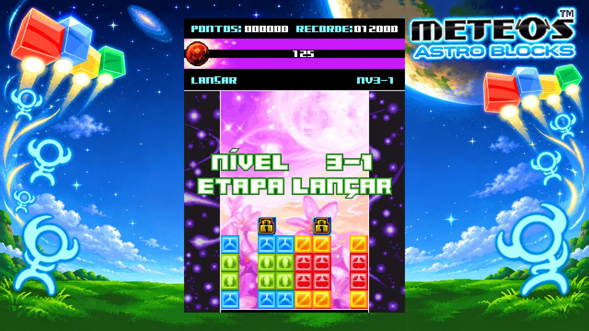

# Legacy Mobile Forge — testing preview

Windows tooling for adapting Java ME games with reusable video settings, controller input, English/pt-BR UI, local logs and portable packaging. The implemented backend runs J2ME JARs using FreeJ2ME-Plus. **This is not a universal or native C++ recompiler.** Native Symbian/SIS support is a separate investigation.

## Meteos Astro Blocks



*Development preview with a custom illustrated border. Public builds use a neutral border by default; the illustrated border is not bundled with the build.*

See [Meteos setup and required game version](ports/meteos/README.md). The supported input is **MIDlet 1.0.4, 240×320**, 303,829 bytes, SHA-256 `5756d421e3b878d124fb9c8453a6738ecb99ff6425679668ab2cb6e7b6df5021`. Supply your own original JAR. Other variants are not validated.

Download the [game-free Windows launcher](https://github.com/piecarlos/legacy-mobile-forge/releases/tag/v0.2.1-preview.1), extract the ZIP and open **MeteosLauncher.exe**. Java is included. On the first launch, select your original JAR; the launcher verifies and copies it locally. No compiler is needed to play, and no game is included or downloaded. Normal rendering is recommended; ReShade is optional and experimental.

The commands below are for developers building from source:

```powershell
.\scripts\Setup-Dependencies.ps1
.\scripts\Build-MeteosPreview.ps1 -GamePath 'C:\Games\meteos_astro_blocks_240x320_171711.jar' -Package
```

Build requirements: Windows x64, PowerShell and JDK 21+. Generated portable packages include Java. Dependencies are verified against `dependencies.lock.json`; do not swap runtime snapshots between builds. Craft Anything supplies deeper game triage when installed.

## Another game / Work

Open this project in Work and ask: “Read AGENTS.md, docs/STATUS.md and docs/NATIVE-PORTING.md. The next game is at C:\Games\game.jar. Use Craft Anything, preserve the original, establish a working Java reference and evaluate a native C++ route. Use Arlecchino/Enigma only where useful and record actual blockers.”

See the [native investigation workflow](docs/NATIVE-PORTING.md) and [per-game plan template](templates/GAME-PLAN.md). **Arlecchino and Enigma help recover/understand Java; they are not Java-to-C++ compilers.** A native translator remains an unvalidated candidate. Copy the plan into the private case and preserve the current Java route while testing it. No native backend is installed or integrated by these instructions.

```powershell
.\scripts\New-GameProject.ps1 -GamePath 'C:\Games\game.jar' -Id my-game -Title 'My Game' -Width 240 -Height 320
.\scripts\Build-GameProject.ps1 -ProjectPath .\games\my-game -Package
```

Each game needs validation of handset APIs, screen size, input, sound and saves. JAD is a descriptor and needs its JAR. SIS/SISX is not interchangeable with J2ME. The generic engine offers SDL3 mapping and a Win32 fallback; the Meteos adapter retains its tested Win32 path. A GameSir was user-tested on Meteos. Xbox/PlayStation devices and other machines remain unverified.

## Feedback

Settings → General opens the local log folder. No automatic telemetry or GitHub upload. Report steps, build, normal/ReShade, controller/connection and approximate time in an issue; attach the latest reviewed session log. Never attach the commercial JAR, personal saves or credentials.

## Public versus private

- Public: original launcher/bridge source, original demo fixture, build scripts, game requirements and documentation.
- Private: original games, saves, commercial art, extracted files, generated game packages and ReShade binaries.
- `games/`, `build/`, `dependencies/`, `experiments/` and personal logs stay outside Git.

Own code: GPL-3.0-or-later. See [third-party notices](THIRD-PARTY.md). No affiliation with game publishers. C++ recompilation research and the Blogger catalog are future work.

## Português

Base para adaptar jogos Java ME no Windows, com menus, controles, idiomas e logs locais. **Não é um recompilador universal.** Para Meteos, use exclusivamente a variante 1.0.4 de 240×320 com o hash acima. O jogo não acompanha o repositório. O launcher pronto está em Releases e pede seu JAR na primeira execução. Veja [instruções do Meteos](ports/meteos/README.md). Para o próximo jogo, siga o [roteiro de investigação nativa](docs/NATIVE-PORTING.md); Arlecchino/Enigma são auxiliares de análise, e a rota C++ ainda precisa ser demonstrada.
